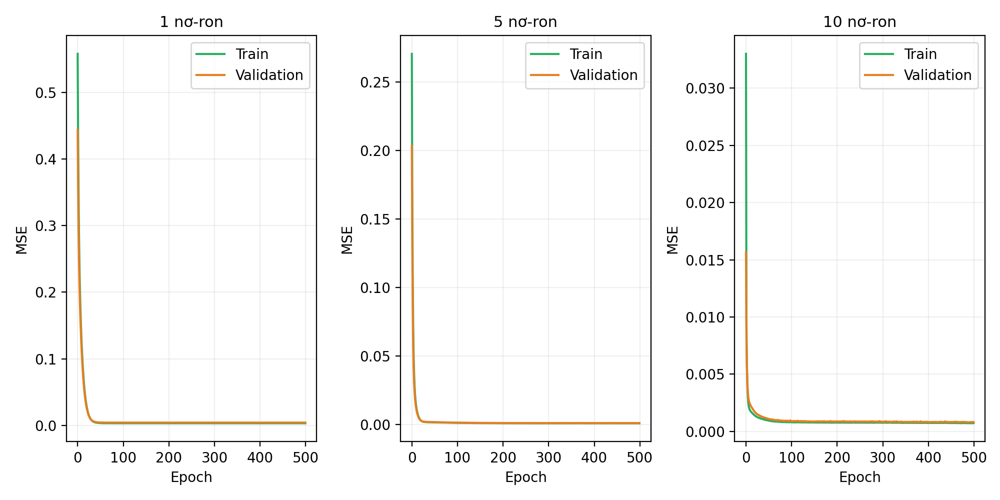

# Thực nghiệm B – Ảnh hưởng số nơ-ron tầng ẩn đến MLP

## Mô tả

Thực nghiệm khảo sát ảnh hưởng của số nơ-ron tầng ẩn (từ 1 đến 10) đến khả năng của mạng MLP một tầng ẩn trong việc xấp xỉ hàm mật độ Gaussian hai chiều. Báo cáo kết quả và hình minh họa cũng có trong [report.ipynb](report.ipynb).

## Thiết lập thực nghiệm

- Hàm mục tiêu: Gaussian 2D, với vector kỳ vọng `μ = [0, 0]` và ma trận hiệp phương sai `C = [[0.3, -0.5], [-0.5, 2.0]]`.
- Miền lấy mẫu: `x₁ ∈ [-2, 2]`, `x₂ ∈ [-4, 4]`.
- Số mẫu: 1.000 train, 300 validation, 100 test.
- Seed: `42`.
- MLP: đầu vào 2 chiều, một tầng ẩn dùng ReLU, đầu ra 1 chiều.
- Huấn luyện: batch size 32, tối đa 500 epochs, Adam với learning rate `0.001`.
- Số nơ-ron tầng ẩn được thử: `1` đến `10`.
- Chọn checkpoint theo validation MSE; sau đó đánh giá trên tập test. Các chỉ số được lưu gồm MSE, MAE và RMSE.

## Cấu trúc thư mục

```text
BTL/
├── README_B.md
├── requirements.txt
├── expB_neurons.py
├── report.ipynb
└── expB_results/
    ├── expB_summary.csv
    ├── model_B_hid1.pth ... model_B_hid10.pth
    ├── data_distribution.png
    ├── expB_error_curve.png
    ├── expB_learning_curves.png
    └── expB_surface_comparison.png
```

Các tệp trong `expB_results/` được tạo khi chạy chương trình. Thư mục này hiện cũng chứa sẵn kết quả của lần chạy trước.

## Cài đặt và chạy

Mở terminal tại thư mục chứa `README_B.md`, sau đó chạy:

```bash
python -m pip install -r requirements.txt
python expB_neurons.py
```

Chương trình tự chọn GPU nếu PyTorch nhận diện được CUDA, nếu không sẽ chạy trên CPU. Thời gian chạy phụ thuộc vào phần cứng.

## Kết quả đầu ra

Sau khi chạy, chương trình lưu các kết quả vào `expB_results/`:

- `expB_summary.csv`: kết quả validation và test cho từng số nơ-ron.
- `expB_run.log`: log có dấu thời gian, ghi các bước chạy, tiến độ huấn luyện và kết quả từng mô hình.
- `model_B_hid1.pth` đến `model_B_hid10.pth`: trọng số các mô hình.
- `data_distribution.png`: phân bố dữ liệu huấn luyện.
- `expB_error_curve.png`: sai số theo số nơ-ron.
- `expB_learning_curves.png`: đường học của một số mô hình.
- `expB_surface_comparison.png`: so sánh bề mặt hàm mục tiêu và dự đoán.

Để chèn một hình vào notebook, thêm một ô Markdown trong `report.ipynb` và dùng đường dẫn tương đối từ thư mục dự án, ví dụ:

```markdown

```
